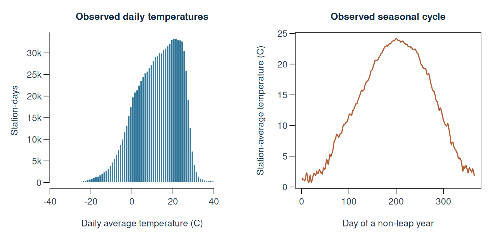
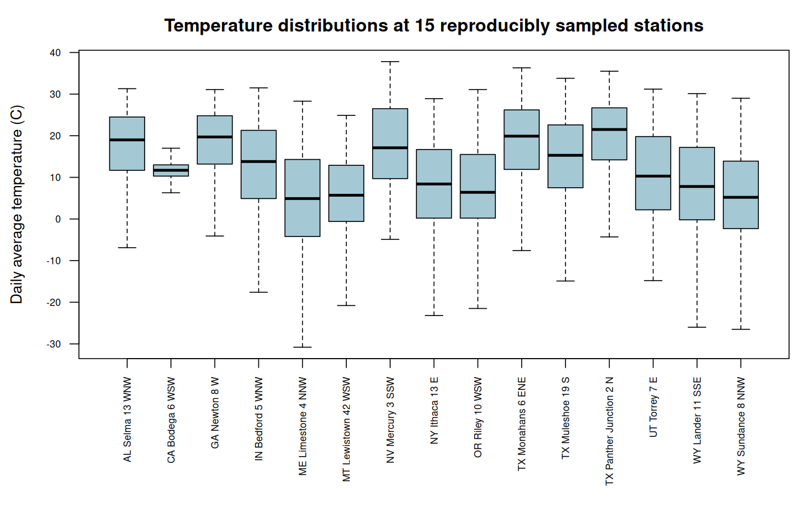
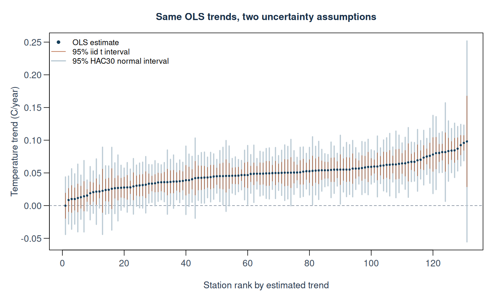
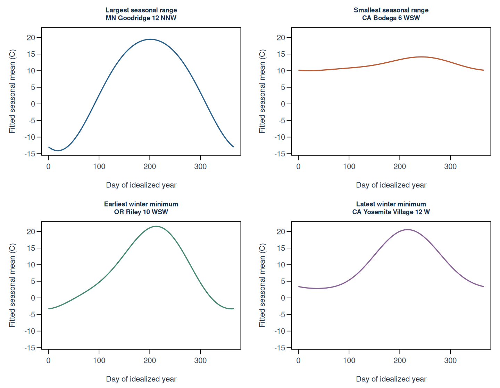
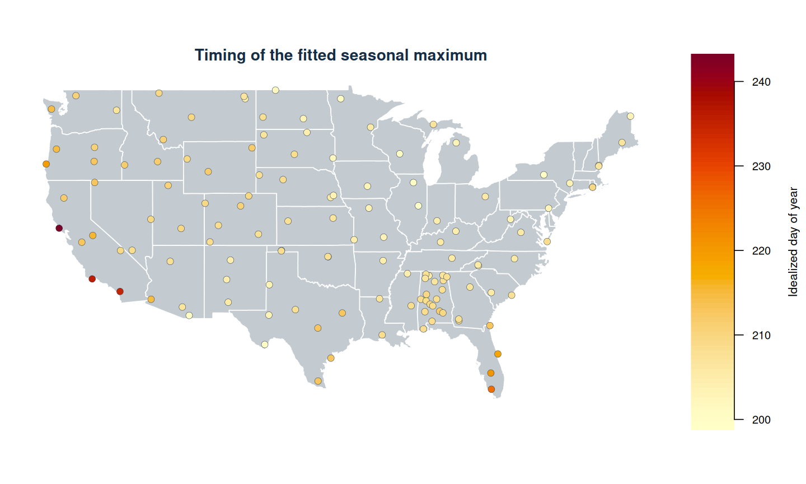
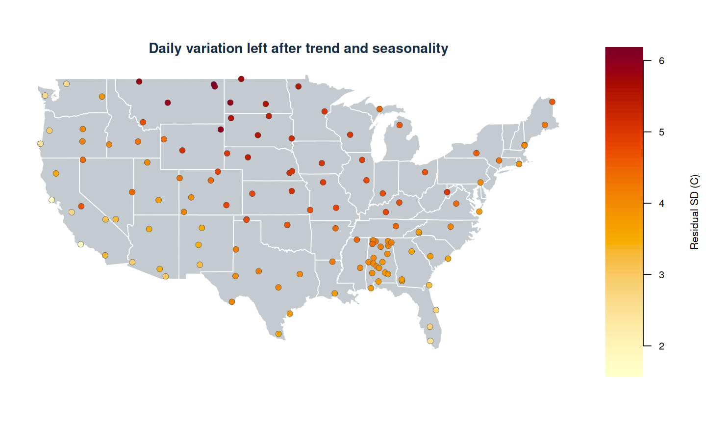
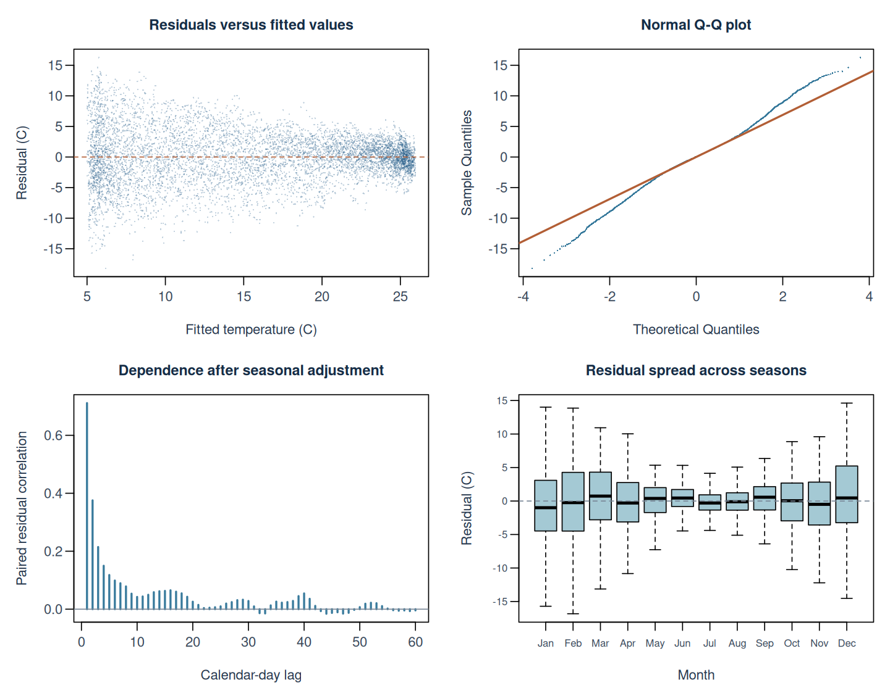

# Seasonality and temperature trends in climate station data

## Question and approach

How can a linear model separate a recurring annual temperature cycle from a gradual change in baseline temperature? How do the seasonal range, timing, and residual variability differ across stations?

This independent project began in **SDS 439: Linear Statistical Models**. It uses daily average temperatures from a course-provided NOAA climate-station dataset. The analysis keeps the original station-specific ordinary least squares (OLS) model, then adds data checks, clearer parameter interpretations, residual diagnostics, and an autocorrelation-robust uncertainty sensitivity analysis.

The model describes the supplied observation windows. It does not estimate a causal effect or construct an area-weighted national temperature index.

## 1. Prepare one consistent analysis sample

[NOAA's daily-product documentation](https://www.ncei.noaa.gov/pub/data/uscrn/products/daily01/readme.txt) defines `T_DAILY_AVG` in degrees Celsius and uses `-9999` for missing values in this field. Those codes must become missing values **before** any plot or model. We omit missing responses rather than filling them with invented temperatures. Other meteorological variables are not used in this analysis.


```r
prepared <- read_climate_data("data/raw/uscrn_daily.RData")
dat <- prepared$data
coverage <- prepared$coverage
knitr::kable(prepared$audit, col.names = c("Audit measure", "Count"), format = "pipe")
```


|Audit measure             |  Count|
|:-------------------------|------:|
|raw_rows                  | 959126|
|raw_stations              |    132|
|temperature_sentinels     |  10433|
|other_missing_response    |      0|
|outside_scope_rows        |   7584|
|outside_scope_stations    |      1|
|in_scope_rows             | 951542|
|in_scope_missing_response |  10412|
|modeled_rows              | 941130|
|modeled_stations          |    131|
|duplicate_station_dates   |      0|

The supplied file contains **132 stations**, including `ON_Egbert_1_W` in Ontario. Restricting the main analysis to station prefixes in the contiguous United States leaves **131 stations** and **941,130 usable station-days**. The usable observations span **2001-06-04 to 2025-04-18**. Each station is fitted over its own available window; these are not a common-period panel.

Station coverage, excluded stations, missing responses, gaps, and coordinate checks are saved in `results/station_coverage.csv`. A station needs at least 100 valid days and a full-rank six-column design; every station included in this run passes. No missing dates are silently collapsed into adjacent days in the dependence calculations.


|Coverage measure                        |Value |
|:---------------------------------------|:-----|
|Shortest usable station span (years)    |8.43  |
|Longest usable station span (years)     |23.87 |
|Fewest usable observations at a station |3,073 |
|Most usable observations at a station   |8,655 |

## 2. Explore temperatures before fitting

<div class="figure">

<p class="caption">plot of chunk temperature-overview</p>
</div>

The histogram pools all usable station-days, so longer records contribute more observations. The seasonal display instead averages temperatures within each station and calendar day, then averages those station summaries. February 29 is omitted only from this display so month and day align on a non-leap calendar. Leap-day observations remain in every fitted model. Neither display is an area-weighted national estimate.

<div class="figure">

<p class="caption">plot of chunk station-distributions</p>
</div>

These 15 stations are sampled with a fixed seed. The boxes summarize the middle half of each station's temperatures; outlier points are hidden for readability, not deleted from the data. Geographic differences and seasonal swings both contribute to their spread.

## 3. Specify the harmonic linear model

Let $d_i$ be days since January 1, 2020, $t_i=d_i/365.25$, and $j(i)$ identify the station. Fit:

$$
Y_i = \alpha_{j(i)} + \beta_{j(i)}t_i
+ a_{1,j(i)}\sin(2\pi t_i) + c_{1,j(i)}\cos(2\pi t_i)
+ a_{2,j(i)}\sin(4\pi t_i) + c_{2,j(i)}\cos(4\pi t_i)
+ \varepsilon_i.
$$

This is a **linear model in its coefficients**: sine and cosine are known columns of the design matrix, even though they are nonlinear functions of time. OLS estimates the six coefficients by minimizing the sum of squared residuals.

- **Annual sine and cosine:** together allow a seasonal cycle with its own size and phase. A sine term alone would constrain the timing of the peak.
- **Semiannual sine and cosine:** allow the cycle to depart from one symmetric sinusoid. They add two fixed basis functions, not a separate causal mechanism.
- **Separate station fits:** every coefficient can differ by station. The shared basis does not force all stations to share a seasonal curve. There is no pooling or information sharing between stations.
- **Trend, $\beta_j$:** change in the fitted baseline per year, in degrees Celsius/year, holding seasonal phase fixed. It is not the temperature change from one day to the next, which also includes seasonality.
- **Intercept, $\alpha_j$:** the seasonally adjusted baseline at the reference time. The harmonic component averages to zero over a full idealized cycle. At January 1, 2020 itself, the fitted temperature is $\alpha_j+c_{1,j}+c_{2,j}$, since the cosine terms equal one. Thus the intercept is not the predicted January 1 temperature.

The classical teaching model assumes independent, mean-zero Gaussian errors with constant variance **within** a station. Different stations may have different variances. Normality is not required to compute OLS estimates; the classical exact t intervals additionally rely on the stated error assumptions. Temporal dependence will be checked rather than assumed away.


```r
models <- fit_stations(dat)
trends <- summarize_models(models)
seasonal <- seasonal_features(models)
features <- merge(trends, seasonal$features, by = "site")
features <- merge(features, us_coverage, by = "site")
selected <- select_cycles(seasonal$features)
```

The reusable implementation in `R/analysis_helpers.R` creates a named list of fitted models. The same fits supply slopes, uncertainty, seasonal summaries, and diagnostics; identical regressions are not rerun for each figure.

## 4. Estimate trends and distinguish effect size from uncertainty

<div class="figure">

<p class="caption">plot of chunk trend-intervals</p>
</div>

All points are OLS slopes. The narrow orange intervals use the classical formula with a t critical value and station-specific residual degrees of freedom. The wider blue-gray intervals use a **30-calendar-day Bartlett HAC covariance estimate** and a normal critical value. HAC stands for heteroskedasticity- and autocorrelation-consistent; here it is a specified sensitivity calculation, not a guarantee that every source of dependence has been removed.


|Summary                                     |Value      |
|:-------------------------------------------|:----------|
|Stations with positive estimated trends     |130 of 131 |
|Unweighted mean station trend (C/year)      |0.0483     |
|Median station trend (C/year)               |0.0492     |
|Minimum station trend (C/year)              |-0.0001    |
|Maximum station trend (C/year)              |0.0981     |
|Classical 95% intervals entirely above zero |122        |
|HAC30 95% intervals entirely above zero     |95         |

The unweighted mean slope is **0.048 C/year**, or **0.48 C per decade** when the fitted rates are rescaled. This is a descriptive average across this station sample and its differing windows. It is not a national climate trend estimate or a prediction that the same change will continue.

The largest point estimate belongs to OH_Wooster_3_SSE, whose usable record spans only 8.43 years. Its HAC30 interval runs from -0.056 to 0.252 C/year. A high-ranked slope need not be the most precisely estimated one.

A confidence interval crossing zero means the data and chosen uncertainty model do not rule out zero at that level; it does not prove that the trend is exactly flat. These are **pointwise** station intervals, with no adjustment for examining many stations. Spatially correlated weather also means stations are not independent replications of national evidence.

### Sensitivity to temporal dependence


```r
lags <- c(7L, 30L, 90L)
hac_summary <- do.call(rbind, lapply(lags, function(lag) {
  se <- trends[[paste0("hac", lag, "_se")]]
  data.frame(lag_days = lag, median_se_ratio_to_iid = median(se / trends$iid_se),
             intervals_above_zero = sum(trends$trend_c_per_year - qnorm(0.975) * se > 0))
}))
knitr::kable(hac_summary, digits = 2, format = "pipe")
```


| lag_days| median_se_ratio_to_iid| intervals_above_zero|
|--------:|----------------------:|--------------------:|
|        7|                   1.84|                  105|
|       30|                   2.13|                   95|
|       90|                   2.27|                   88|

The lag choices are disclosed comparisons, not a data-selected optimal bandwidth. The function weights residual score pairs by their **actual calendar separation**, using declining Bartlett weights through lag $L$. Missing-day scores are zero placeholders in the covariance calculation; temperatures are not imputed. The finite-sample multiplier uses the number of observed fitted rows, $n/(n-6)$.

The implementation is checked against `sandwich::NeweyWest()` for complete daily data and an independent pair-weight calculation for data with gaps. It uses no prewhitening. Dependence at longer lags, informative missingness, an incorrect mean model, and cross-station correlation are not solved by this calculation. Fixed bandwidth choices alone do not establish asymptotic consistency. See the [HAC implementation](R/calendar_hac.R) and [numerical checks](tests/validate_hac.R).

## 5. Summarize the seasonal curves

To measure seasonality alone, hold the trend at the reference baseline and vary the harmonic phase through one full 365.25-day cycle. We evaluate 365 equally spaced phases and label them as days 1–365 of an idealized year. These labels are approximate seasonal dates, not exact dates in leap-year 2020.

The **seasonal peak-to-trough range** is the maximum fitted seasonal mean minus its minimum. The original assignment called this amplitude; for a single sinusoid, the conventional amplitude would be half this range. Holding the trend fixed prevents within-year linear change from entering the seasonal comparison.


|selection               |site                     | seasonal_range_c| coldest_day| warmest_day|
|:-----------------------|:------------------------|----------------:|-----------:|-----------:|
|Largest seasonal range  |MN_Goodridge_12_NNW      |            33.54|          19|         201|
|Smallest seasonal range |CA_Bodega_6_WSW          |             4.14|          21|         243|
|Earliest winter minimum |OR_Riley_10_WSW          |            24.86|         361|         213|
|Latest winter minimum   |CA_Yosemite_Village_12_W |            17.72|          37|         216|

<div class="figure">

<p class="caption">plot of chunk selected-cycles</p>
</div>

The largest modeled seasonal range belongs to **MN_Goodridge_12_NNW**, at **33.54 C**; the smallest belongs to **CA_Bodega_6_WSW**, at **4.14 C**. All panels use the same vertical scale. These are fitted seasonal means, not forecasts of an individual day's weather.

For the earliest and latest winter minima, we order the cycle from July through June. This puts late December before January in the same winter and avoids incorrectly treating the calendar boundary as a large physical separation. The extrema are plug-in estimates on a daily phase grid; no uncertainty intervals for their timing or range are estimated here.

## 6. Map timing and residual variability at the observed stations

<div class="figure">

<p class="caption">plot of chunk warmest-day-map</p>
</div>

Colors represent station estimates, with no spatial interpolation. The latest seasonal peak in this sample is at **CA_Bodega_6_WSW**, around day **243**. A geographical pattern may suggest a mechanism to investigate, but this regression does not test explanations such as ocean influence or atmospheric circulation.

<div class="figure">

<p class="caption">plot of chunk residual-sd-map</p>
</div>

Residual standard deviation is $\hat\sigma_j=\sqrt{\mathrm{SSE}_j/(n_j-6)}$, calculated with `sigma(fit)`. Values range from **1.59 to 6.16 C**. Larger values mean daily temperatures depart further from this smooth fitted mean. They do not, by themselves, identify the cause or imply that the seasonal fit is useless.

This is a residual scale estimate, not the standard error of the slope, the standard deviation of unadjusted temperatures, or a prediction interval. Under correlated errors, the usual independent-error unbiasedness interpretation of the residual variance need not hold.

## 7. Diagnose what the model leaves behind


```r
# Choose the station nearest the median residual SD, rather than a visually favorable example.
diagnostic_site <- trends$site[which.min(abs(trends$residual_sd_c - median(trends$residual_sd_c)))]
```

The diagnostic station is **AL_Cullman_3_ENE**, selected by a reproducible rule before inspecting its plots.

<div class="figure">

<p class="caption">plot of chunk residual-diagnostics</p>
</div>

Read these diagnostics as different questions:

- **Residuals versus fitted:** does the remaining spread or mean pattern depend on the fitted temperature?
- **Normal Q-Q:** are the tails compatible with a Gaussian approximation? Normal-looking residuals would not establish independence.
- **Calendar-lag correlation:** are residuals from nearby dates related after adjusting the mean? Each bar uses pairs separated by that many calendar days; it is not an ACF computed after compressing gaps.
- **Residuals by month:** is constant within-station variance plausible across the seasons?

At this selected station, residual spread is visibly larger in colder months and the Q-Q tails depart from the line. Constant variance and Gaussian tails are imperfect descriptions, separately from the clear temporal dependence.

Across all fitted stations, median consecutive-day residual correlation is **0.71**, ranging from **0.62 to 0.82**. This is direct evidence against treating daily residuals as independent, and it motivates showing HAC uncertainty alongside the classical teaching model.

Median in-sample $R^2$ is **0.775**. A high value can largely reflect predictable seasonality; it does not establish accurate trend uncertainty or out-of-sample forecasting performance. No forecast evaluation is performed in this project.

## 8. What this analysis supports

The fitted models give a compact description of three distinct features: a gradual change in baseline, a repeating seasonal mean, and daily variability around that mean. Most fitted station slopes are positive in this dataset, while seasonal range and timing vary substantially across locations. Accounting for serial dependence changes the uncertainty assessment without changing the OLS point estimates.

The main limits are unequal observation windows and station density, remaining temporal and spatial dependence, missing observations, a time-invariant seasonal shape, and a linear baseline within each observed window. Extending the model with nonlinear trends, additional harmonics, or correlated errors requires a reasoned comparison and diagnostics; adding flexibility is not automatically an improvement.

## Reproducible outputs


```r
write.csv(prepared$audit, "results/data_audit.csv", row.names = FALSE)
write.csv(coverage, "results/station_coverage.csv", row.names = FALSE)
write.csv(features, "results/station_results.csv", row.names = FALSE)
write.csv(selected, "results/selected_stations.csv", row.names = FALSE)
write.csv(hac_summary, "results/hac_sensitivity.csv", row.names = FALSE)
write.csv(summary_table, "results/summary.csv", row.names = FALSE)
coefficients <- do.call(rbind, lapply(names(models), function(site) {
  b <- coef(models[[site]]$fit)
  data.frame(site = site, term = names(b), estimate = unname(b))
}))
write.csv(coefficients, "results/model_coefficients.csv", row.names = FALSE)
write.csv(data.frame(day = 1:365, seasonal$curves, check.names = FALSE),
          "results/seasonal_curves.csv", row.names = FALSE)
manifest <- data.frame(file = "uscrn_daily.RData", bytes = file.info("data/raw/uscrn_daily.RData")$size,
                       md5 = unname(tools::md5sum("data/raw/uscrn_daily.RData")))
write.csv(manifest, "results/input_manifest.csv", row.names = FALSE)
writeLines(capture.output(sessionInfo()), "results/session_info.txt")
```

The input fingerprint identifies the supplied course snapshot; it does not imply that today's live NOAA archive is identical. Raw data are kept outside Git history. See [data instructions](data/README.md), [setup and running instructions](README.md), and [validation and changes](VALIDATION.md).

## References

- NOAA NCEI: [USCRN overview](https://www.ncei.noaa.gov/access/crn/) and [daily-product field documentation](https://www.ncei.noaa.gov/pub/data/uscrn/products/daily01/readme.txt).
- R documentation: [`lm`](https://stat.ethz.ch/R-manual/R-devel/library/stats/html/lm.html), [`confint`](https://stat.ethz.ch/R-manual/R-devel/library/stats/html/confint.html), [`sigma`](https://stat.ethz.ch/R-manual/R-devel/library/stats/html/sigma.html), and [`predict.lm`](https://stat.ethz.ch/R-manual/R-devel/library/stats/html/predict.lm.html).
- Zeileis, A. (2004). Econometric Computing with HC and HAC Covariance Matrix Estimators. *Journal of Statistical Software*, 11(10). [Article and implementation details](https://sandwich.r-forge.r-project.org/articles/pdf/sandwich.pdf).
- `sandwich` documentation: [Newey-West HAC covariance estimation](https://sandwich.r-forge.r-project.org/reference/NeweyWest.html).

The course project supplied the original question and two-harmonic station model. This repository presents the revised implementation and explicitly identified uncertainty extension.
